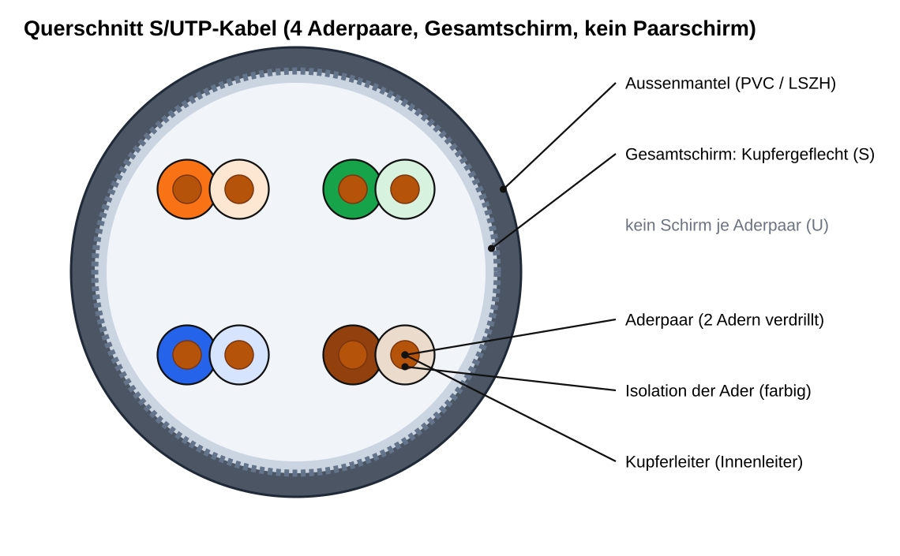

# Netzwerk-Grundlagen – Übung 2

**Autor:** Gresa Hisa  
**Datum:** 25.11.2026  
**Modul:** 117 Netzwerke

## Frage 1
PCA: 192.168.100.11, Maske 255.255.255.0. Wie lautet die Netzwerkadresse?

**Antwort: 192.168.100.0** (die ersten drei Oktette stehen im Netzanteil, der Hostanteil wird 0)

## Frage 2
Gültige A-Klasse-Adressen: **47.25.18.149** und **118.76.255.255**

127.0.0.1 ist reserviert (Loopback). 148.55.0.1 ist Klasse B, 193.170.10.1 ist Klasse C.

## Frage 3
Bereich der Klasse C: **192 – 223**

## Frage 4
Zur Adresse 169.254.45.89 stimmen:
- Es ist eine Autokonfigurationsadresse (APIPA), die sich der PC selber vergibt, wenn er keine Adresse vom DHCP-Server bekommt.
- Sie gehört zur B-Klasse.
- Sie hat die Standard-Subnetzmaske 255.255.0.0.

Falsch: «darf jedem PC als fixe Adresse vergeben werden».

## Frage 5
Private Adressen: **192.168.100.56** und **10.15.20.25**

## Frage 6
Querschnitt durch ein S/UTP-Kabel: siehe `querschnitt_s_utp.png`.

S/UTP hat einen Gesamtschirm aus Kupfergeflecht (S), die Aderpaare sind nicht einzeln geschirmt (U).

## Frage 7
Maximale Länge eines Twisted-Pair-Kabels: **100 Meter**

## Frage 8
Stecker eines Twisted-Pair-Kabels: **RJ-45**

## Frage 9
Twisted-Pair-Kabel mit montierten Steckern: **Patch-Kabel**

## Frage 10
Richtig:
- Lichtwellenleiter haben eine höhere Datenübertragungskapazität als Twisted-Pair-Kabel.
- Twisted-Pair-Kabel sind günstig.
- Twisted-Pair-Kabel haben 8 Kupferleiter.

Falsch: «unempfindlich gegenüber elektromagnetischen Feldern». Das hängt von der Schirmung ab.
