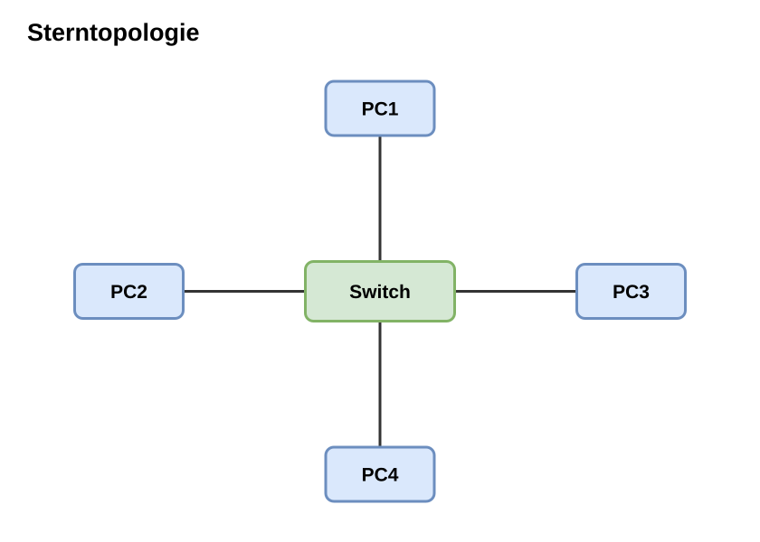
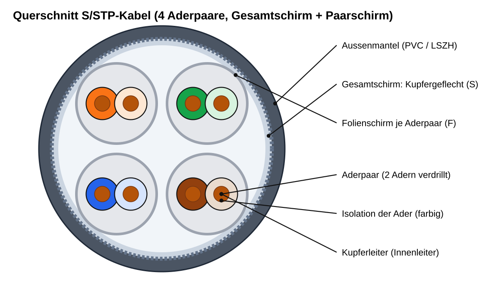

# Netzwerk-Grundlagen – Übung 3

**Autor:** Gresa Hisa  
**Datum:** 25.11.2026  
**Modul:** 117 Netzwerke

## Frage 1
Broadcast-Adressen:
- **221.25.197.255** (Maske 255.255.255.0)
- **89.255.255.255** (Maske 255.0.0.0)
- **195.7.255.255** (Maske 255.255.255.0)

Nicht Broadcast: 145.78.255.200 mit /16 (die Broadcast-Adresse wäre 145.78.255.255) und 112.67.255.255 mit /8 (die Broadcast-Adresse wäre 112.255.255.255).

## Frage 2
Private Adressen: **172.23.145.10** und **192.168.67.2**

172.35.20.11 liegt ausserhalb von 172.16 – 172.31, 127.56.234.69 ist Loopback, 196.162.160.44 ist öffentlich.

## Frage 3
Gültige Adressen der Klasse A: **78.253.0.147**, **23.210.178.62**, **119.255.0.255**

132.3.56.221 ist Klasse B, 114.0.0.0 ist eine Netzadresse und damit keine Hostadresse.

## Frage 4
Sterntopologie: siehe `sterntopologie.png`.

## Frage 5
Vorteile der Ringtopologie:
- garantierte Bandbreite
- Paketkollisionen sind ausgeschlossen

## Frage 6
Querschnitt durch ein S/STP-Kabel: siehe `querschnitt_s_stp.png`.

S/STP hat einen Gesamtschirm aus Kupfergeflecht (S) und zusätzlich einen Folienschirm um jedes einzelne Aderpaar (STP).

## Frage 7
Richtig:
- Kabel der Kategorie 7 müssen doppelt abgeschirmt sein.
- Twisted-Pair-Kabel können bis 40 Gbit/s Daten leiten.

Falsch: «ist abhörsicher» und «darf bis 150 Meter lang sein» (maximal 100 Meter).

## Frage 8
Boutiquen in Zürich, Uster und Horgen plus Lager in Wallisellen: **Wide Area Network (WAN)**, weil mehrere getrennte Standorte verbunden sind.
